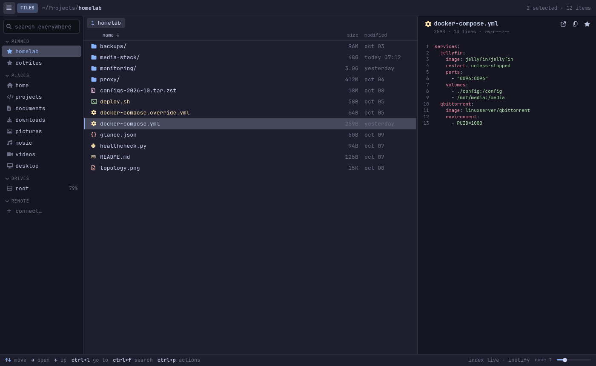
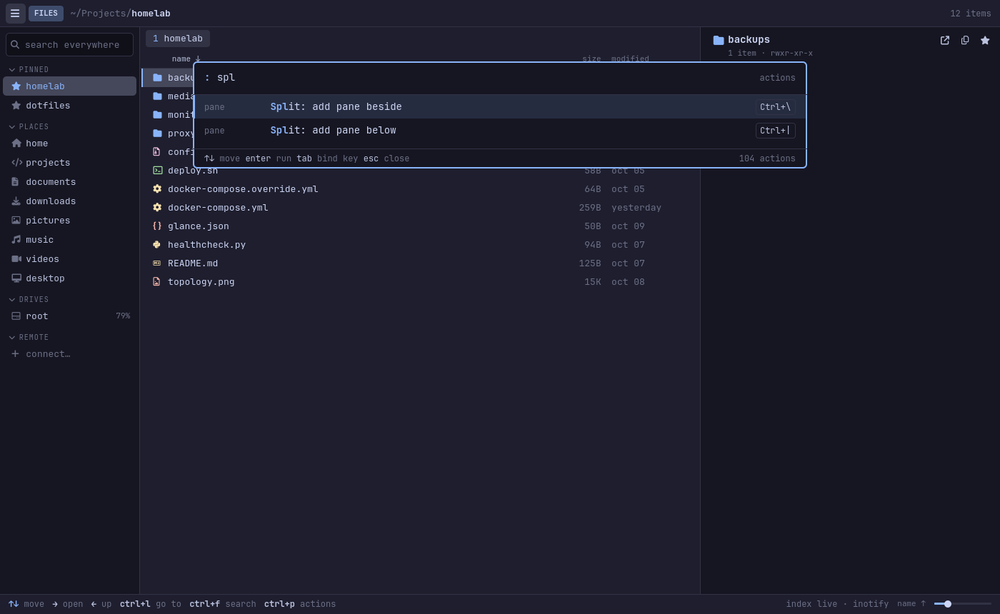
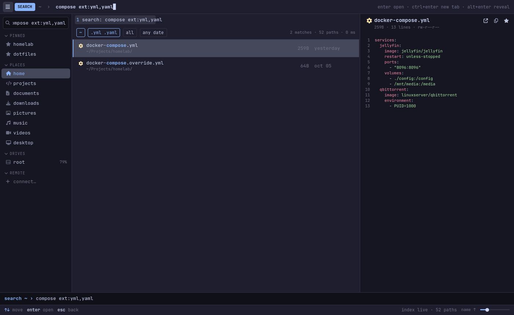
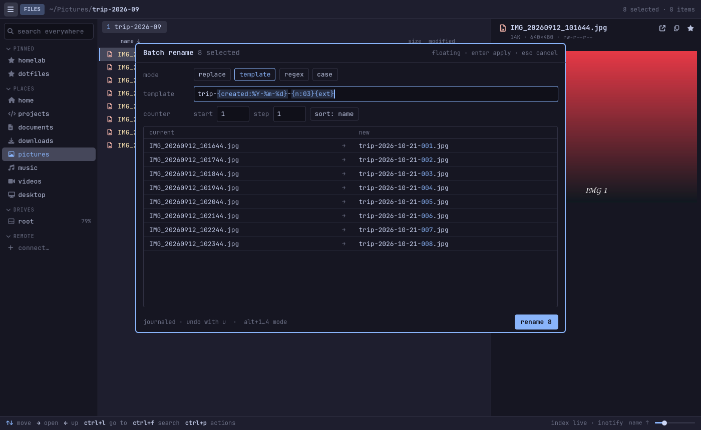
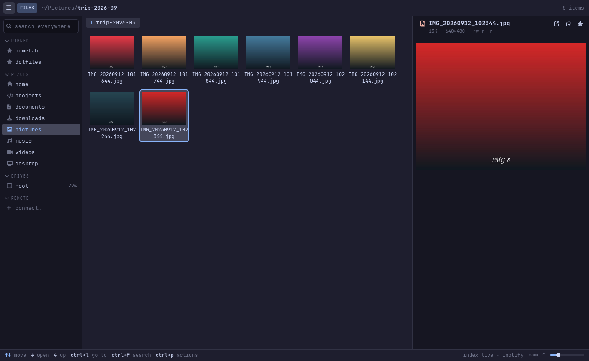
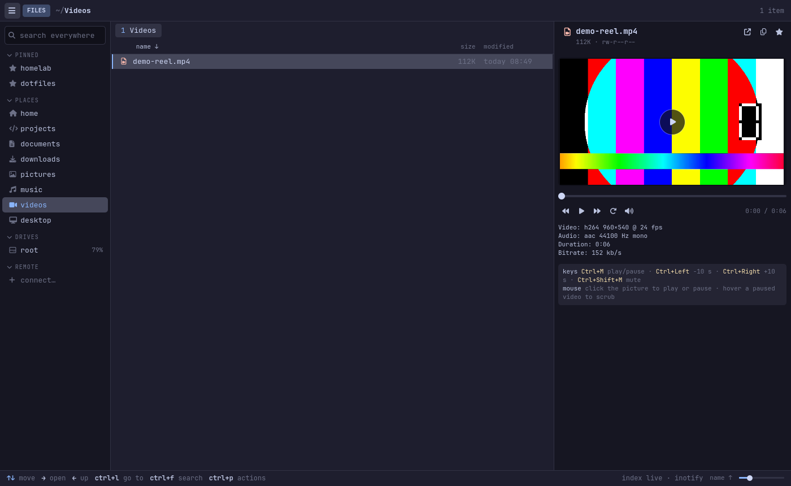
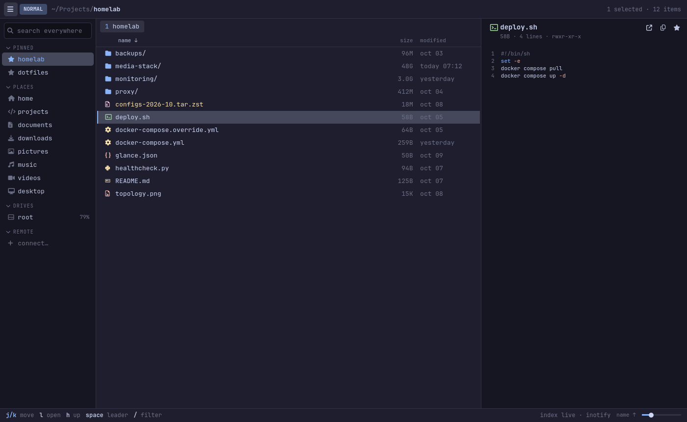
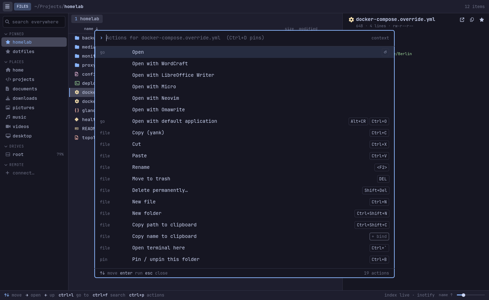
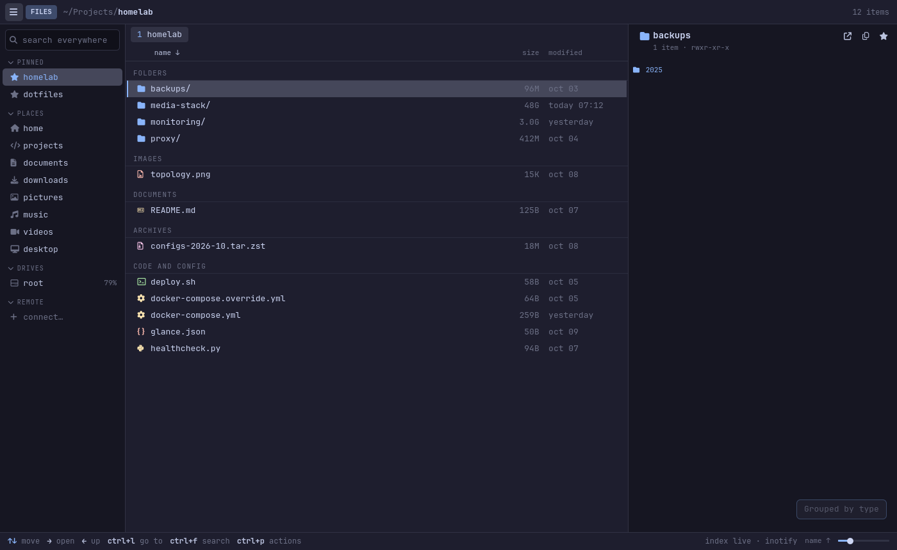
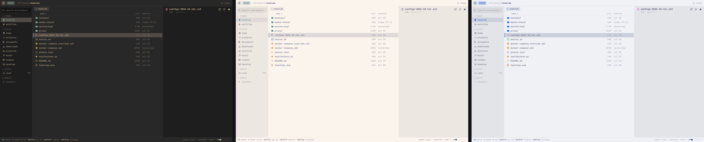

# CaptainFM

**A fast, keyboard-first file manager for Omarchy and Hyprland.** A Qt 6 QML interface over a Rust core,
joined in-process by [cxx-qt](https://github.com/KDAB/cxx-qt). It opens a 100,000-file folder in about 70 ms,
indexes a 300,000-file home folder in about a fifth of a second, searches it in a few milliseconds, and recolors
itself live with your Omarchy theme.

The feature set is inspired by [File Pilot](https://filepilot.tech/) on Windows; the name, UI and code are original.



[Getting started](#getting-started) · [Highlights](#highlights) · [Install](#install) · [Keys](#keys-at-a-glance) ·
[Command line](#command-line) · [Plugins](#configuration-and-plugins) · [Development](#development) · [How-to guide](docs/HOWTO.md)

## Getting started

You need Rust, Qt 6 and a C++ compiler (Arch: `sudo pacman -S rust qt6-declarative qt6-multimedia base-devel`).

```sh
git clone https://github.com/jgarza9788/CaptainFM.git
cd CaptainFM
./build.sh --quick     # builds in about a minute and installs `captainfm` (and the short name `cfm`) to ~/.local/bin
cfm                    # starts CaptainFM (your last tabs, or home); `cfm ~/Downloads` opens that folder in a tab
```

Then three keys get you most of the way:

1. **`Ctrl-P`** opens the command palette: type a few letters of anything you want to do, press `Enter`.
2. **`Ctrl-F`** searches the current folder and everything under it as you type; **`Ctrl-L`** jumps to a folder.
3. **Arrow keys** move and open, **`Ctrl-C` / `Ctrl-V`** copy and paste, **`Del`** trashes, **`Ctrl-Z`** undoes.

Prefer Vim keys? Press `Ctrl-Shift-K` to switch (`j` `k` `l` `h`, a `Space` leader with a which-key popup).
Settings are on `Ctrl-,`. CaptainFM never changes your default file manager unless you ask it to
(`captainfm --default`, see [Install](#install)). Use `./build.sh` without `--quick` for the smaller, optimised build.

## Highlights

- **Instant everything.** Async folder reads with live refresh, background folder sizes, a drive-wide
  index for fuzzy search (`Ctrl-F`), and a global search box at the top of the sidebar.
- **Two ways to drive it.** File Pilot style keys by default (Ctrl shortcuts, arrows, type to find), or modal
  Vim keys with a `Space` leader and a which-key popup. Switch with `Ctrl-Shift-K`.
- **One command palette for everything** (`Ctrl-P`). Words in order or `re:regex`, aliases, inline key
  rebinding, and when no command matches it becomes a go-to for folders.
- **Real previews.** Syntax-highlighted code, images (including HEIC, TIFF, RAW), video with transport
  controls, audio, PDFs, Office documents, Markdown, CSV tables, fonts and archives, plus e-books, comics,
  SQLite, certificates, torrents, calendars and contacts through small built-in plugins you can switch off.
- **Tabs, up to four panes, saved layouts**; list, tree, Miller, icons (thumbnails) and columns views;
  group by type, date or size.
- **Pins, jump bar, batch rename, undo/redo**, devices and remotes (SMB, SFTP, FTP, WebDAV, MTP, and cloud drives through rclone) with saved connections and keyring-stored passwords, drag and drop.
- **Transfers you can watch.** Copies and moves show progress, speed and time left in a panel, can be paused or cancelled (`Space x p`, `Space x c`, `Space x x` shows the panel), and ask whether to replace, skip or keep both on name clashes.
- **Fits Omarchy:** live theme sync, your system font, frameless, sane at half-screen tile width, a
  file-picker portal (Open/Save dialogs of other apps), drag and drop with other apps, and `FileManager1`.
- **Settings for everything** (`Ctrl-,`): start behavior, keys, view defaults, font, units, drop behavior, terminal.
- **Extensible** with Lua actions, QML side panels and file previews.
- **Lean:** one ~10 MB binary on top of Qt 6, no daemon, and almost nothing running while it sits idle.

| | |
| --- | --- |
|  |  |
|  |  |
|  |  |
|  |  |

Every color comes from the active Omarchy theme:



## Install

Needs Rust, Qt 6 (`qt6-declarative`, `qt6-multimedia`) and a C++ toolchain. Optional helpers unlock more previews
and features: `ffmpeg`, `imagemagick`, `poppler`, `libarchive` (`bsdtar`), `sqlite`, `openssl`, `wl-clipboard`,
`gvfs`, `udisks2`, and `rclone` (a separate package, see https://rclone.org/install/) + `libsecret` for cloud drives and remembered passwords.

```sh
git clone https://github.com/jgarza9788/CaptainFM.git
cd CaptainFM
./build.sh          # optimised build (about 6 minutes); installs ~/.local/bin/captainfm, the cfm alias, desktop entry and icon
./build.sh --quick  # the faster build (about 1 minute), a bit larger
```

**Choosing built-in plugins at build time.** The rarely used previews are plugins compiled into the program
(names: `torrent`, `calendar-contacts`, `sqlite`, `system`, `documents`); leave out the ones you do not want:

```sh
./build.sh --no-plugins               # none of the built-in plugins
./build.sh --without torrent,sqlite   # everything except these
./build.sh --only sqlite,system       # just these
./build.sh --dry-run --only sqlite    # show the cargo command and stop
# or with cargo directly:
cargo build --release --no-default-features --features plugin-sqlite,plugin-system
```

CaptainFM does not change your default file manager or keybindings on its own. To make it the folder handler
(and undo that later):

```sh
captainfm --default        # inode/directory -> CaptainFM
captainfm --default off    # restore the previous handler
```

## Keys at a glance

| Do this | Keys (File Pilot) | Keys (Vim) |
| --- | --- | --- |
| Move, open, go up | arrows, `Enter`, `Backspace` | `j` `k` `l` `h` |
| Run any command | `Ctrl-P` | `Space Space` or `:` |
| Go to a folder | `Ctrl-L` | `z` |
| Search this folder / the drive | `Ctrl-F` / `Ctrl-Shift-F` | `Space f f` / `Space f d` |
| Copy, cut, paste | `Ctrl-C` `Ctrl-X` `Ctrl-V` | `yy` `dd` `p` |
| Rename / batch rename | `F2` | `r` / `R` |
| Trash / undo | `Del` / `Ctrl-Z` | `dt` / `u` |
| Pin the current folder | `Ctrl-B` | `Space p f` |
| New tab, split pane | `Ctrl-T`, `Ctrl-\` | `Ctrl-T`, `Ctrl-w v` |
| Copy / move to the other pane | `F7` / `F8` | `Space w y` / `Space w m` |
| Show, pause or cancel transfers | palette: "transfers" | `Space x x` / `Space x p` / `Space x c` |
| Preview pane, views | `Ctrl-I`, `Alt-1`…`Alt-6` | `Space v i`, `Space v l` … |

Everything else is in the **[how-to guide](docs/HOWTO.md)**: daily use step by step, every view, searching, pins,
batch rename, devices and remotes, themes, configuration, plugins, full key tables and troubleshooting.

## Command line

```
captainfm [--select <path>] [path...]   open folders as tabs; --select highlights an item
captainfm --tab <path...>               open folders as tabs in the already running window
captainfm --install                     install the desktop entry and icon for this user
captainfm --default [off]               become (or stop being) the folder handler
captainfm --install-portal [off]        use CaptainFM as the file picker (xdg-desktop-portal)
captainfm --install-dbus                let other apps open folders in CaptainFM (FileManager1)
```

## Configuration and plugins

Settings, key overrides, aliases, layouts and plugins live under `~/.config/captainfm/`; pins and recent folders
under `~/.local/share/captainfm/`. Plugins add Lua actions, QML side panels and file previews (the rarely used previews are built-in plugins you can switch off); two examples are in
[`examples/plugins/`](examples/plugins). Details: [configuration files](docs/HOWTO.md#configuration-files) and
[plugins](docs/HOWTO.md#plugins).

Switching the built-in plugins on and off (a plugin that is off costs nothing and its previews fall back to plain text):

```sh
captainfm --plugins                   # list plugins, on or off
captainfm --plugin torrent off        # switch one off (short name, or the full id preview-torrent)
captainfm --plugin torrent on
captainfm --plugin all off            # all of them; `all on` brings them back
```

Inside the app: open the command palette (`Ctrl-P`) and type `plugins` for "Plugins: turn off …" / "turn on …" per plugin
and "turn all on" / "turn all off", or use **Settings > Plugins** (`Ctrl-,`). A running window picks up a change made
on the command line when you switch back to it.

## Development

```sh
cargo test                      # ~160 unit tests: fuzzy matching, listing, index, file ops and undo, transfers, pins, D-Bus, plugins, previews
cargo clippy --release --all-targets
./scripts/screenshots.sh        # regenerate docs/images from a synthetic home folder (headless)
python3 scripts/bench.py        # startup, folder listing and drive-index timings of a release build
```

The UI can be driven headlessly for screenshots and smoke tests:

```sh
export QT_QPA_PLATFORM=offscreen
CFM_SIZE=1400x860 CFM_KEYS="<Down> <Down> @view.tree <Right>" CFM_SHOT=/tmp/shot.png captainfm /some/folder
```

`CFM_KEYS` is a space-separated list of key tokens (`j`, `<C-d>`, `<Space>`), `@command.id`, `=text` (types into
the focused field; `_` is a space), `!accept`, `!next`, `!mode:template`, `!clear` and `!play`. `CFM_SHOT` saves
a window image and quits, `CFM_DEBUG=1` prints timings, `CFM_KEYMAP=vim|fp` picks the keymap. Point
`XDG_CONFIG_HOME`, `XDG_DATA_HOME` and `XDG_CACHE_HOME` somewhere temporary to keep test runs away from your state.

Layout: `src/` Rust (`dir_model`, `listing`, `index`, `fuzzy`, `ops`, `transfer`, `preview`, `preview_extra`,
`plugins`, `devices`, `remotes`, `batch`, `dbus`, `theme`, `state`, `thumbnails`), `qml/` interface,
`packaging/` desktop assets and the built-in plugins (`packaging/plugins/`), `scripts/` tooling (screenshots, demo
recordings, benchmarks). Planned work is in [`todo.md`](todo.md).

## License

[MIT](LICENSE) © 2026 Justin Garza.
